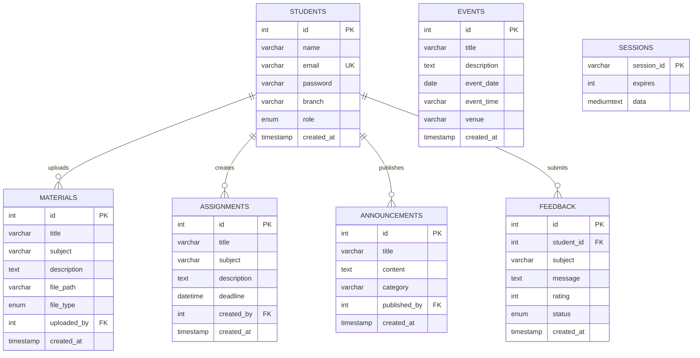

# CollegeHub – Smart College Management System

An end-to-end, beginner-friendly, full-stack web application designed for academic colleges, universities, and technical institutes. **CollegeHub** streamlines campus learning, coursework tracking, student-faculty communication, and administrative workflows through a centralized portal.

---

## 1. Abstract
In traditional educational institutions, academic communication and material distribution are often fragmented across disparate channels such as physical notice boards, messaging groups, individual cloud drives, and email threads. This fragmentation results in missed assignment deadlines, difficulty in accessing lecture notes, delayed notice dissemination, and lack of structured student feedback. 

**CollegeHub** addresses these challenges by offering a unified, lightweight, and responsive web platform built using pure **HTML5, CSS3, Vanilla JavaScript, Node.js, Express.js, and MySQL**. It provides distinct role-based experiences for students and administrators, enabling efficient distribution of study materials, real-time assignment tracking, campus announcements, event management, and structured feedback collection.

---

## 2. Problem Statement
Educational institutions often face the following operational hurdles:
1. **Inefficient Distribution of Study Materials:** Students struggle to locate authorized lecture slides, syllabus copies, and reference PDFs scattered across multiple social media groups.
2. **Untracked Coursework Deadlines:** Students frequently miss project and homework submission dates due to lack of a centralized schedule.
3. **Delayed Campus Announcements:** Urgent exam notices, timetable revisions, and administrative circulars take time to reach all students.
4. **Lack of Anonymous/Structured Feedback Channels:** Students lack a direct, organized avenue to submit academic inquiries and infrastructure feedback to administrators.
5. **Overcomplicated Software Systems:** Commercial ERP solutions are often bloated, expensive, and difficult for beginner computer science students and evaluators to understand, audit, and deploy locally.

---

## 3. Project Objectives
- Build a lightweight, full-stack web platform using fundamental, native web technologies without third-party frontend frameworks.
- Implement secure, role-based authentication (RBAC) separating student access from administrative privileges.
- Provide a responsive, accessible user interface optimized for desktop, tablet, and mobile browsers.
- Utilize parameterized MySQL queries to defend against SQL injection attacks.
- Secure passwords using standard `bcrypt` hashing algorithms.
- Establish persistent session management to maintain authentication states across page refreshes and server reboots.
- Provide full administrative control over coursework, materials, notices, and events.

---

## 4. Technologies Used

| Layer | Technology | Purpose |
|---|---|---|
| **Frontend Structure** | HTML5 | Semantic web page markup and forms |
| **Frontend Styling** | CSS3 (Pure) | Custom responsive layout, CSS variables, blue-white theme (No Bootstrap/Tailwind) |
| **Frontend Scripting** | Vanilla JavaScript (ES6+) | Client-side DOM manipulation, asynchronous Fetch API, form validation |
| **Backend Runtime** | Node.js | Non-blocking, event-driven JavaScript server runtime |
| **Web Framework** | Express.js | HTTP routing, REST API endpoints, middleware architecture |
| **Relational Database**| MySQL (5.7+ / 8.0+) | Persistent relational data store with foreign key constraints |
| **Database Driver** | `mysql2/promise` | Connection pooling with async/await query execution |
| **Session Management** | `express-session` & `express-mysql-session` | Persistent server-side sessions stored in MySQL |
| **Password Security** | `bcryptjs` | Salting and hashing passwords (10 salt rounds) |
| **File Uploads** | `multer` | Handling multipart/form-data and filtering PDF uploads |
| **Configuration** | `dotenv` | Environment variable management |

---

## 5. System Requirements

### Hardware Requirements
- **Processor:** Intel Core i3 / AMD Ryzen 3 or higher.
- **RAM:** Minimum 2 GB (4 GB recommended).
- **Storage:** 500 MB free hard disk space.

### Software Requirements
- **Operating System:** Windows 10/11, macOS, or Linux (Ubuntu 20.04+).
- **Node.js:** v16.x, v18.x, or v20.x LTS.
- **MySQL Server:** v5.7, v8.0, or MariaDB 10.4+.
- **Database GUI (Optional):** MySQL Workbench, phpMyAdmin, or DBeaver.
- **Code Editor:** Visual Studio Code (VS Code).
- **Web Browser:** Google Chrome, Mozilla Firefox, Microsoft Edge, or Safari.

---

## 6. System Architecture

CollegeHub implements a classic **Three-Tier Architecture (Client-Server-Database)**:

```mermaid
flowchart TD
    subgraph Client_Layer ["Client Tier (Browser)"]
        UI["HTML5 + CSS3 + Vanilla JS"]
        FetchAPI["Asynchronous Fetch API"]
    end

    subgraph Server_Layer ["Application Tier (Node.js & Express.js)"]
        StaticServer["Express Static Server (Public Assets & Uploads)"]
        Router["REST API Routing Layer"]
        AuthMid["auth.js & admin.js Middleware"]
        SessionStore["express-mysql-session Persistent Store"]
        MulterEng["Multer PDF Upload Engine"]
    end

    subgraph Database_Layer ["Data Tier (MySQL Relational DB)"]
        MySQLPool["MySQL Connection Pool (mysql2)"]
        Tables[("collegehub Database
        - students
        - materials
        - assignments
        - announcements
        - events
        - feedback
        - sessions")]
    end

    UI -->|User Interactions| FetchAPI
    FetchAPI -->|HTTP REST Requests (JSON/Multipart)| Router
    Router --> AuthMid
    AuthMid --> SessionStore
    Router --> MulterEng
    MulterEng -->|Store PDF| StaticServer
    Router --> MySQLPool
    MySQLPool -->|Parameterized SQL Queries| Tables
```

---

## 7. Modules and Features

### A. Authentication & Session Module
- **Student Registration:** Students sign up with Full Name, College Email, Academic Branch, and Password. Role is strictly assigned to `'student'` on the server to prevent privilege escalation.
- **Login Verification:** Validates credentials against stored `bcrypt` password hashes. Sets an HTTP-only session cookie.
- **Role-Based Redirection:** Admins are automatically routed to `/admin.html`; students are routed to `/dashboard.html`.
- **Session Termination:** Destroys server session record and clears browser cookie on logout.

### B. Student Dashboard Module
- Displays student details (Name, Email, Academic Branch, Role).
- Provides quick-navigation cards to Study Materials, Assignments, and Events.
- Displays the latest 5 campus announcements.
- Contains an interactive feedback form to submit suggestions and ratings directly to the administration.

### C. Academic Study Materials Module
- Students can browse uploaded course notes and lecture guides.
- Live keyword search and departmental subject filtering (CSE, IT, ECE, ME, CE, EE).
- One-click access to open or download PDF documents.
- Administrators can upload PDF files (up to 15MB) or supply external web links.

### D. Assignment & Deadline Tracking Module
- Lists coursework assignments sorted in chronological order of deadline.
- Dynamic deadline calculator:
  - Red badge: *Deadline Passed (Overdue)*
  - Orange badge: *Due Soon (Today / Tomorrow)*
  - Green badge: *X Days Remaining*
- Administrators can create, edit, and delete coursework assignments with problem statements and due dates.

### E. Announcements & Notice Board Module
- Disseminates urgent exam notices, departmental circulars, and college holiday notifications.
- Categorized by tag: General, Exam, Academic, and Holiday.
- Administrators have complete authority to publish, update, and remove announcements.

### F. College Events & Seminar Module
- Displays upcoming campus hackathons, technical symposiums, webinars, and cultural festivals.
- Displays Event Name, Schedule Date, Time, Venue, and Description.
- Administrators can create and manage event entries.

### G. Student Feedback & Query System
- Students submit queries or suggestions with a 1-to-5 star rating.
- Automatically links the student's ID via the session.
- Administrators view feedback entries accompanied by student name, email, and branch.
- Administrators can toggle status between **Pending** and **Reviewed**, or delete resolved items.

### H. Administrator Control Center
- Real-time statistics counters for enrolled students, materials, assignments, announcements, events, and feedback.
- Clean tabbed interface to manage all academic modules without leaving the page.
- Directory of all registered students with account removal controls (admin accounts are protected).

---

## 8. Database Design & Schema

### Database Name: `collegehub`



---

## 9. API Documentation

| HTTP Method | API Endpoint | Description | Auth Required | Role Required | Request Body (JSON/Form) | Success Response |
|---|---|---|---|---|---|---|
| `POST` | `/api/auth/register` | Registers a new student | No | Anyone | `{ name, email, branch, password }` | `201 Created` + user object |
| `POST` | `/api/auth/login` | Authenticates student/admin | No | Anyone | `{ email, password }` | `200 OK` + session cookie |
| `POST` | `/api/auth/logout` | Clears active session | Yes | Any | None | `200 OK` + redirect info |
| `GET` | `/api/auth/me` | Returns current profile | Yes | Any | None | `200 OK` + user profile |
| `GET` | `/api/students/stats` | Returns aggregate counts | Yes | `admin` | None | `200 OK` + count object |
| `GET` | `/api/students` | Lists all students | Yes | `admin` | None | `200 OK` + array |
| `DELETE` | `/api/students/:id` | Deletes a student account | Yes | `admin` | None | `200 OK` + message |
| `GET` | `/api/materials` | Lists study materials | Yes | Any | Query: `?subject=&search=` | `200 OK` + array |
| `POST` | `/api/materials` | Adds study material | Yes | `admin` | `FormData` (file or URL) | `201 Created` |
| `DELETE` | `/api/materials/:id` | Deletes a material | Yes | `admin` | None | `200 OK` |
| `GET` | `/api/assignments` | Lists active assignments | Yes | Any | None | `200 OK` + array |
| `POST` | `/api/assignments` | Creates an assignment | Yes | `admin` | `{ title, subject, description, deadline }` | `201 Created` |
| `PUT` | `/api/assignments/:id` | Edits an assignment | Yes | `admin` | `{ title, subject, description, deadline }` | `200 OK` |
| `DELETE` | `/api/assignments/:id` | Deletes an assignment | Yes | `admin` | None | `200 OK` |
| `GET` | `/api/announcements` | Lists announcements | No | Anyone | Query: `?limit=50` | `200 OK` + array |
| `POST` | `/api/announcements` | Publishes notice | Yes | `admin` | `{ title, content, category }` | `201 Created` |
| `DELETE` | `/api/announcements/:id`| Deletes notice | Yes | `admin` | None | `200 OK` |
| `GET` | `/api/events` | Lists college events | Yes | Any | None | `200 OK` + array |
| `POST` | `/api/events` | Adds a campus event | Yes | `admin` | `{ title, description, event_date, event_time, venue }` | `201 Created` |
| `DELETE` | `/api/events/:id` | Deletes an event | Yes | `admin` | None | `200 OK` |
| `POST` | `/api/feedback` | Submits feedback | Yes | `student` | `{ subject, rating, message }` | `201 Created` |
| `GET` | `/api/feedback` | Lists all feedback | Yes | `admin` | None | `200 OK` + array with student info |
| `PATCH` | `/api/feedback/:id/status`| Toggles review status | Yes | `admin` | `{ status: 'reviewed' }` | `200 OK` |
| `DELETE` | `/api/feedback/:id` | Deletes feedback | Yes | `admin` | None | `200 OK` |

---

## 10. Step-by-Step Setup & Installation Guide

Follow these steps to set up and run CollegeHub on your computer:

### Step 1: Install Node.js
1. Visit [https://nodejs.org/](https://nodejs.org/) and download the **LTS (Long Term Support)** installer.
2. Run the downloaded installer and complete the setup wizard (ensure *"Add to PATH"* is checked).
3. Verify your installation by opening Command Prompt / PowerShell and running:
   ```bash
   node -v
   npm -v
   ```

### Step 2: Install MySQL Server & MySQL Workbench
1. Download **MySQL Community Server** from [https://dev.mysql.com/downloads/installer/](https://dev.mysql.com/downloads/installer/).
2. During setup:
   - Select **Developer Default** or **Server only + MySQL Workbench**.
   - Set a root password (e.g., `root` or `admin123`) and remember it.
   - Complete installation and verify MySQL service is running in Windows Services (`services.msc`).

### Step 3: Open the Project in Visual Studio Code
1. Launch **Visual Studio Code**.
2. Click **File -> Open Folder...** and select the `CollegeHub` folder.
3. Open an integrated terminal in VS Code: **Terminal -> New Terminal** (or press `` Ctrl + ` ``).

### Step 4: Install Dependencies
In the VS Code terminal, execute:
```bash
npm install
```
This installs `express`, `mysql2`, `express-session`, `express-mysql-session`, `bcryptjs`, `multer`, and `dotenv`.

### Step 5: Create Database & Execute SQL Script
Open **MySQL Workbench** (or your MySQL Command Line Client):
1. Connect to your local MySQL instance using your `root` password.
2. Open the file `database.sql` (located in the project root folder) in MySQL Workbench.
3. Click the **Execute (Lightning icon)** button to execute the entire script.
   Alternatively, run from the command line:
   ```bash
   mysql -u root -p < database.sql
   ```
4. This script automatically creates the `collegehub` database, all necessary tables, constraints, and inserts seed records.

### Step 6: Configure the `.env` File
Open the `.env` file in the project root and configure your MySQL credentials:
```env
PORT=3000
NODE_ENV=development
DB_HOST=localhost
DB_PORT=3306
DB_USER=root
DB_PASSWORD=your_actual_mysql_password
DB_NAME=collegehub
SESSION_SECRET=collegehub_super_secret_session_key_2024_secure
```

### Step 7: Initialize / Reset Admin Credentials (Optional Helper)
Run the built-in script to verify connectivity and initialize the default test accounts:
```bash
node create-admin.js
```

### Step 8: Start the Server
Start the Express server by executing:
```bash
npm start
```
You should see:
```text
[Database] Successfully connected to MySQL database: "collegehub"
[Session] Persistent MySQL session store initialized.
====================================================
 CollegeHub Server is running on port 3000
 Web Portal URL: http://localhost:3000
 Environment:    development
====================================================
```

### Step 9: Open in Browser
Open your browser and navigate to:
```
http://localhost:3000
```

---

## 11. Test Credentials

The database script provides pre-seeded accounts for testing:

| Role | Email | Password | Access Level |
|---|---|---|---|
| **Administrator** | `admin@collegehub.com` | `admin123` | Full access to `/admin.html` and CRUD operations |
| **Student** | `rahul.sharma@collegehub.com` | `student123` | Access to `/dashboard.html`, materials, assignments, feedback |
| **Student (Alt)** | `priya.patel@collegehub.com` | `student123` | Access to student portal |

> **Evaluation Tip:** On the Login page (`/login.html`), click the **Student Demo** or **Admin Demo** button to auto-fill these credentials.

---

## 12. Testing & Verification Procedure

| Test Scenario | Action Performed | Expected Outcome | Result |
|---|---|---|---|
| **1. Student Registration** | Register with a new name, email, branch, and password (≥6 chars) on `/register.html`. | Account created in MySQL, session initiated, redirected to `/dashboard.html`. | Pass |
| **2. Duplicate Registration** | Attempt to register with an already existing email. | Returns `409 Conflict` with clear alert message: *"An account with this email address already exists."* | Pass |
| **3. Password Validation** | Enter a password with fewer than 6 characters or mismatching confirmation. | Client and server block submission with descriptive error banner. | Pass |
| **4. Valid Student Login** | Log in with `rahul.sharma@collegehub.com` / `student123`. | Authenticates via bcrypt, session cookie created, redirected to `/dashboard.html`. | Pass |
| **5. Invalid Login** | Log in with incorrect password. | Returns `401 Unauthorized` with message *"Invalid email or password."* | Pass |
| **6. Protected Page Access** | Directly open `http://localhost:3000/dashboard.html` without logging in. | Redirected to `/login.html`. | Pass |
| **7. Admin Privilege Enforcement** | Log in as student, then attempt to navigate to `http://localhost:3000/admin.html`. | Access denied alert triggered; redirected back to `/dashboard.html`. | Pass |
| **8. Admin Login** | Log in with `admin@collegehub.com` / `admin123`. | Redirected directly to `/admin.html` Control Center. | Pass |
| **9. Upload Study Material** | Admin uploads a PDF file or specifies an external URL. | Record inserted into `materials` table, file saved to `/uploads/`, visible in student catalog. | Pass |
| **10. File Type Validation** | Attempt to upload a `.exe` or `.txt` file instead of `.pdf`. | Multer rejects upload with error: *"Only PDF documents are allowed."* | Pass |
| **11. Create Assignment** | Admin creates assignment with subject and future deadline. | Appears in student view with dynamic days-remaining countdown tag. | Pass |
| **12. Publish Announcement** | Admin posts notice under "Exam" category. | Instantly appears in Student Dashboard recent announcements feed. | Pass |
| **13. Submit Feedback** | Student submits feedback with 5-star rating. | Stored with `student_id` foreign key; appears in Admin Feedback tab with student's name and department. | Pass |
| **14. Review Feedback Status** | Admin clicks "Mark Reviewed" on a feedback entry. | Status updates to `reviewed` in MySQL, badge switches to green. | Pass |
| **15. Secure Logout** | Click "Logout" button. | Active session destroyed in MySQL `sessions` table, cookie cleared, redirected to `/login.html`. | Pass |

---

## 13. Project Limitations
- **Email Notifications:** The current version does not dispatch automated SMTP email notifications for new announcements or assignment deadlines.
- **Online Assignment Submissions:** While assignments can be published with submission instructions, file submissions by students are intended for future extension.
- **Single Institutional Scope:** Designed for a single college/campus rather than multi-tenant university affiliations.

---

## 14. Future Enhancements
1. **Student Assignment File Submissions:** Allow students to upload completed homework PDFs and allow professors to grade them directly.
2. **Automated Email/SMS Alerts:** Integrate Nodemailer or Twilio for instant alerts when exam schedules or emergency notices are posted.
3. **Attendance Management:** Add a module for faculty to mark and calculate monthly attendance percentages.
4. **Intelligent Chatbot:** Embed an FAQ chatbot to answer common student inquiries regarding college timings, syllabus, and fee schedules.

---

## 15. Conclusion
**CollegeHub – Smart College Management System** demonstrates how fundamental web technologies—HTML5, CSS3, Vanilla JavaScript, Node.js, Express, and MySQL—can be synthesized into an elegant, responsive, and secure academic portal. By adhering to clean code practices, modular route separation, parameterized database operations, and role-based access control, the project serves as an exemplary academic mini-project that is both technically sound and easy to demonstrate.

---

## 16. Common Viva Voce Questions & Answers

### Q1: Why did you choose Vanilla JavaScript instead of React or Angular?
**Answer:** Vanilla JavaScript demonstrates a solid grasp of core web development fundamentals (DOM manipulation, Event Listeners, Fetch API, and Promise handling) without the overhead and abstraction of frontend frameworks. It minimizes build steps, executes natively in any browser, and makes the project lightweight and simple to understand for academic review.

### Q2: How does the application protect against SQL Injection?
**Answer:** All database interactions in CollegeHub utilize **parameterized queries** provided by the `mysql2/promise` library (`pool.execute('SELECT ... WHERE email = ?', [email])`). In parameterized queries, user inputs are treated strictly as data literals rather than executable SQL code, preventing attackers from injecting malicious statements.

### Q3: How are passwords stored securely?
**Answer:** Passwords are never stored in plaintext. They are hashed using `bcryptjs` with 10 salt rounds before being written to the database. `bcrypt` incorporates salt generation to protect against rainbow table attacks and uses a slow cryptographic key derivation function that resists brute-force cracking.

### Q4: How does session management work in this project?
**Answer:** The project uses `express-session` combined with `express-mysql-session`. When a user logs in, a unique session record is stored in the MySQL `sessions` table, and an encrypted, HTTP-only cookie (`collegehub.sid`) is sent to the client browser. For every subsequent request, Express extracts the session ID from the cookie, verifies it against the database, and reconstructs `req.session.user`.

### Q5: What is the purpose of connection pooling in MySQL?
**Answer:** Opening and closing a separate TCP socket connection for every incoming HTTP request is resource-intensive and slow. A connection pool maintains a cache of active database connections (configured with `connectionLimit: 10`) that are reused across requests, significantly improving throughput and server scalability.

### Q6: How do you prevent a student from accessing admin features?
**Answer:** Authorization is enforced at multiple layers:
1. **Frontend:** Navigation and dashboard tabs verify user roles; unauthorized attempts trigger redirection.
2. **Backend Middleware (`admin.js`):** Every administrative API endpoint (`/api/materials`, `/api/assignments`, `/api/announcements`, etc.) is guarded by the `isAdmin` middleware. Even if an attacker manually sends a `POST` or `DELETE` request via Postman or cURL, the server checks `req.session.user.role === 'admin'` and returns `403 Forbidden` if the user is not an administrator.
3. **Registration Protection:** The registration endpoint hardcodes `role = 'student'`, ignoring any role field passed in the request body.

### Q7: What is the difference between `file_type='upload'` and `file_type='url'` in the materials module?
**Answer:** To provide maximum flexibility for professors, CollegeHub supports two distribution modes:
- **`upload`:** The file is physically uploaded from the user's computer via `multer`, saved into the `/uploads/` directory on the server with a unique sanitized timestamp, and served statically.
- **`url`:** For large textbooks or external university notes, the administrator can provide a direct HTTPS link, saving server disk storage.

### Q8: What does the HTTP-only flag on the session cookie do?
**Answer:** The `httpOnly: true` flag prevents client-side JavaScript (e.g., via `document.cookie`) from reading the session cookie. This is a crucial security measure that mitigates the risk of Cross-Site Scripting (XSS) attacks stealing user sessions.

